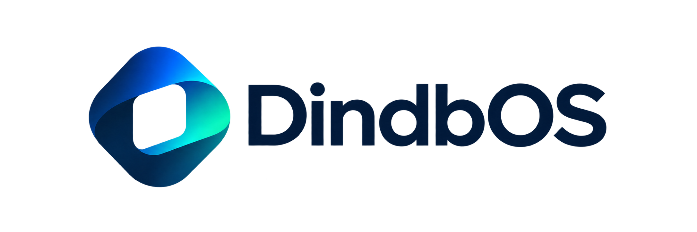
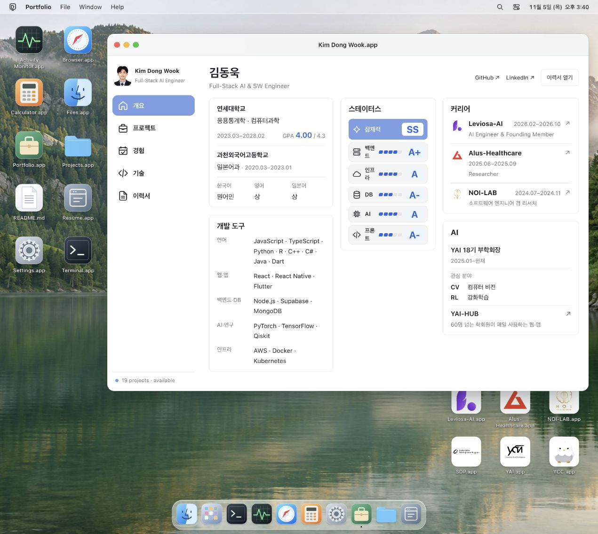
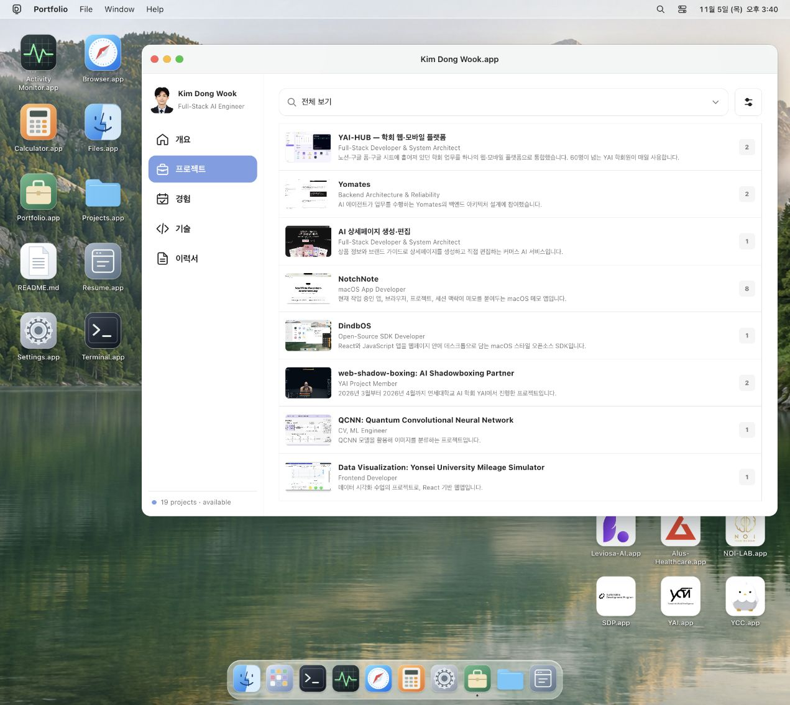
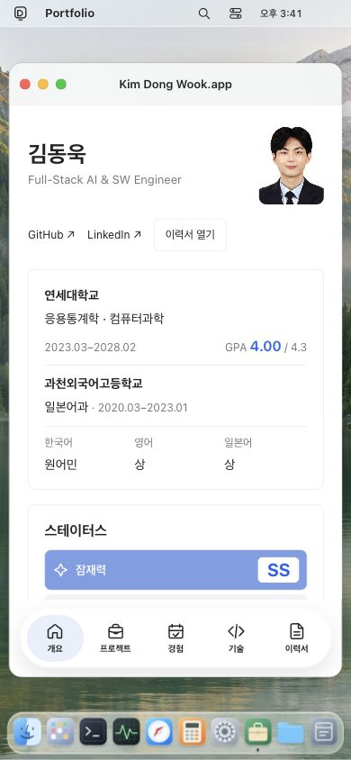
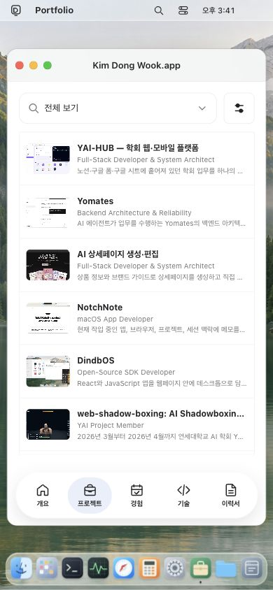

  <picture>
    <source media="(prefers-color-scheme: dark)" srcset="public/brand/dindbos-mark.png">
    
  </picture>

<h1 align="center">Kim Dong Wook · Portfolio</h1>

Explore my work as a desktop. Open a project, an experience, or a file.

Full-Stack AI &amp; SW Engineer · JavaScript + Vite · Powered by DindbOS

<a href="https://dindb-dong.github.io/">Live portfolio</a> · <a href="https://github.com/Dindb-dong/dindbos">DindbOS SDK</a> · <a href="https://dindb-dong.github.io/resume.pdf">Resume</a>

My personal portfolio, built as a working desktop with [DindbOS](https://github.com/Dindb-dong/dindbos). Browse software and AI projects, open dedicated experience apps, read my resume, or explore the same content through Files and Terminal.

## Explore the portfolio

| Open | What you will find |
| --- | --- |
| **Portfolio** | Education, languages, development tools, career, and AI interests |
| **Projects** | Search by title, role, or technology; filter by category and tags; sort and inspect screenshots, videos, and source links |
| **Experience** | Independent apps for Leviosa-AI, Alus-Healthcare, NOI-LAB, SDP, YAI, and YCC |
| **Resume** | An in-app resume view and a downloadable PDF |
| **Files & Terminal** | Portfolio content exposed as virtual files inside the desktop |

Browse in Korean or English, with compact bottom navigation and a stacked project layout on narrow screens. DindbOS provides the windows, Dock, and built-in desktop apps.

Project browser

### On mobile

  
  

Screenshots from the portfolio, with mobile views captured at 390×844. [Artwork and capture details](docs/assets/README.md).

## Credits

Built with [DindbOS](https://github.com/Dindb-dong/dindbos), an MIT-licensed desktop SDK. The logo and favicon use its [transparent brand artwork](https://github.com/Dindb-dong/dindbos/tree/main/docs/assets/brand). Linked projects and third-party materials retain their own licenses.
